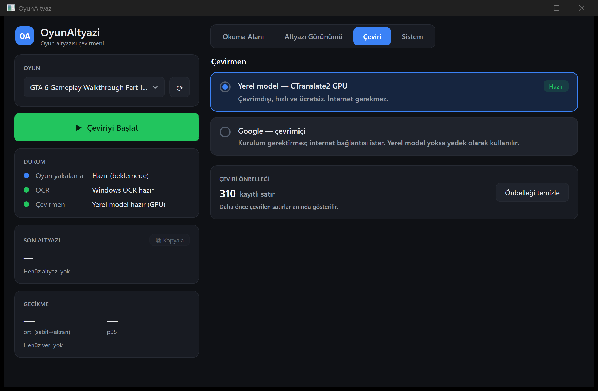
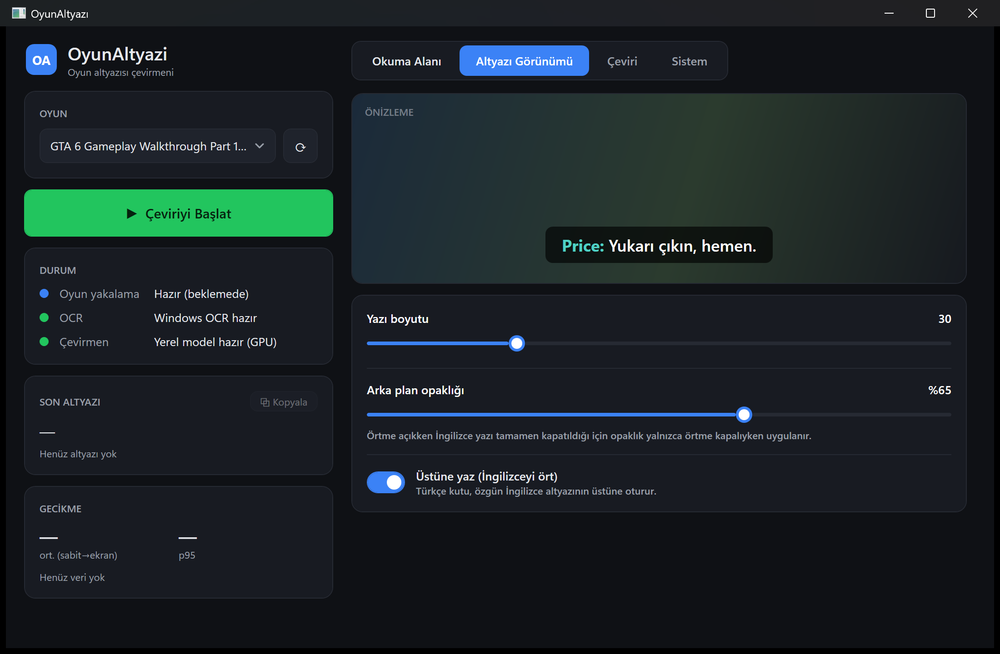
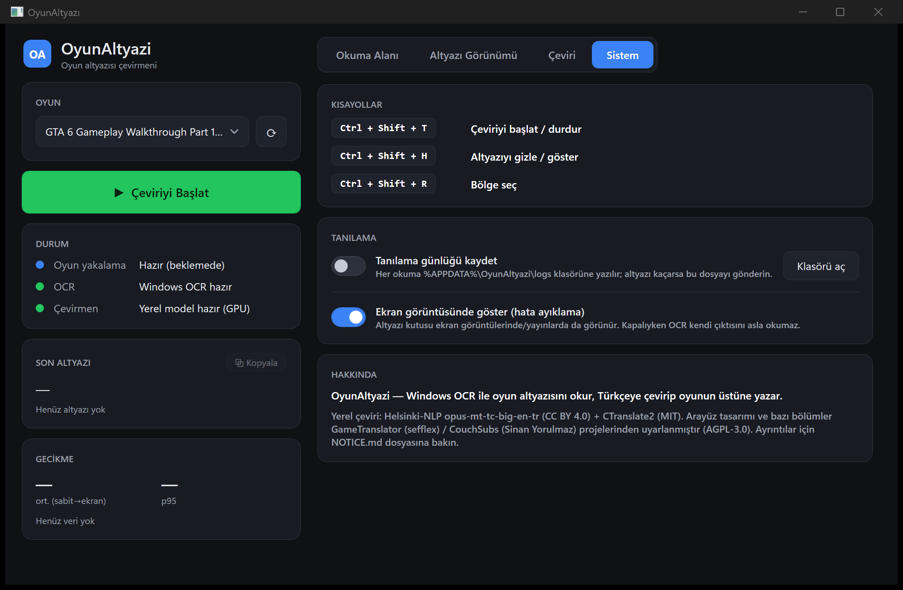

<div align="center">

# OyunAltyazı

**Oyundaki İngilizce altyazıyı Windows OCR ile okur, Türkçeye çevirir ve oyunun üstüne yazar.**

[](https://github.com/berkaygulerr/OyunAltyazi/releases/latest)
[](LICENSE)


[**⬇ OyunAltyazı'yı indir**](https://github.com/berkaygulerr/OyunAltyazi/releases/latest/download/OyunAltyazi-win-Setup.exe)



</div>

## Özellikler

- **Oyunu ekran yakalama ile izler**, seçtiğin bölgedeki (altyazı alanı) metni Windows OCR ile okur.
- **Çevrimdışı yerel çeviri:** Helsinki-NLP `opus-mt-tc-big-en-tr` modeli, CTranslate2 ile (NVIDIA GPU varsa hızlanır). İnternet gerekmez, ücretsizdir. Model yoksa Google çeviriye düşer.
- **Altyazıyı oyunun üstüne yazar:** İngilizce altyazıyı örten Türkçe kutu; yazı boyutu ve opaklık ayarlanabilir.
- **OCR gürültü temizleme:** tuş ipuçları (`[E]`, `Press X`), konuşmacı adları ve OCR hataları ayıklanır; kararlı hale gelmeyen satır çevrilmez.
- **Replikten hazır oyun paketi:** İlk İngilizce replikler cihazda karşılaştırılır. Üç ayrı ayırt edici eşleşme bulunursa yalnızca ilgili paket arka planda indirilir; eşleşmeyen satırlar normal çevrilir.
- **Çeviri önbelleği:** Daha önce çevrilen satırlar anında gösterilir.
- **Paket atölyesi:** Çeviri geçmişindeki bir satırın İngilizcesini ve Türkçesini düzenle, onayladığın satırlardan yerel JSON paketi çıkar. Otomatik paylaşım veya yeniden çeviri yapılmaz.
- **Kısayollar:** `Ctrl+Shift+T` başlat/durdur · `Ctrl+Shift+H` gizle/göster · `Ctrl+Shift+R` bölge seç.
- **Otomatik güncelleme** (Velopack), arka planda sessizce.

| Altyazı görünümü | Sistem |
|---|---|
|  |  |

## Kurulum

1. **[OyunAltyazi-win-Setup.exe](https://github.com/berkaygulerr/OyunAltyazi/releases/latest/download/OyunAltyazi-win-Setup.exe)** dosyasını indirip çalıştır (kalıcı bağlantı, hep son sürümü verir).
2. **Windows SmartScreen** "Windows bilgisayarınızı korudu" derse: **Ek bilgi → Yine de çalıştır**. Uygulama kod imzalı olmadığı için çıkar. Yönetici izni gerekmez; Başlat menüsüne ve masaüstüne kısayol eklenir.
3. İlk açılışta **Kurulum** penceresi yerel çeviri bileşenlerini (Python, CTranslate2, çeviri modeli) indirir: **yaklaşık 300 MB (GPU yoksa) – 900 MB (NVIDIA kartı varsa)**, bir kez. Kesilirse kaldığı yerden devam eder. Bu sırada Google çeviri kullanılabilir; bitince yerel çeviri otomatik seçilir.
4. Windows'ta İngilizce OCR paketi yoksa pencerede **"Windows İngilizce OCR paketini kur"** düğmesi çıkar (yönetici izni ister).
5. Sorun olursa: **Sistem → Bileşenleri onar**.

### Sistem gereksinimleri

- Windows 10 (1903+) veya Windows 11, 64 bit
- Windows İngilizce OCR dil paketi (uygulama kurmayı önerir)
- Yerel çeviri için ~1–3 GB boş disk; GPU önerilir ama şart değil (NVIDIA, CUDA destekli)

## Güncelleme nasıl çalışır?

Uygulama açıkken 30 dakikada bir bu deponun [Releases](https://github.com/berkaygulerr/OyunAltyazi/releases) sayfasındaki yeni sürümü arar, sessizce indirir ve kapanınca uygular. Hazır olunca üstte "Yeni sürüm hazır — Yeniden başlat" bandı çıkar; çeviri sırasında hiçbir şey kendiliğinden kapanmaz. Yeniden kurmana gerek yok.

`main` dalına her push, GitHub Actions ile test → derleme → `vpk pack` → sürüm (`v1.0.N`) yayınlar. `model-v1` etiketli ön-sürüm (prerelease) çeviri modelini barındırır; güncelleme denetimi onu yok sayar.

## Kaynaktan derleme

Gereksinimler: Windows, [.NET 10 SDK](https://dotnet.microsoft.com/download).

```powershell
git clone https://github.com/berkaygulerr/OyunAltyazi.git
cd OyunAltyazi
dotnet test tests/OyunAltyazi.Core.Tests
dotnet test tests/OyunAltyazi.Translation.Tests
dotnet run --project src/OyunAltyazi.App
```

Yerel yayın (CI ile aynı adımlar): `powershell -File tools\release.ps1` (`gh` oturumu ve `dotnet tool install -g vpk --version 1.2.161` gerekir).

## Proje yapısı

```
src/
  OyunAltyazi.App/          WPF arayüz, ekran yakalama, OCR, güncelleme (Velopack)
  OyunAltyazi.Core/         Metin temizleme, kararlılık, eşleştirme, kelime listesi
  OyunAltyazi.Translation/  Çeviri (CTranslate2 / Google), bileşen kurulumu, önbellek
tests/                      xUnit testleri
tools/                      release.ps1, ct2server (model dönüştürme/sunucu), replay
docs/                       ekran görüntüleri, tasarım notları
```

## Lisans ve emeği geçenler

[GNU AGPL-3.0-only](LICENSE). Kodun bir kısmı **[sefflex/GameTranslator](https://github.com/sefflex/GameTranslator)** (AGPL-3.0) ve onun temeli **CouchSubs** (Sinan Yorulmaz) projesinden uyarlanmıştır. Ayrıca:
Helsinki-NLP [opus-mt-tc-big-en-tr](https://huggingface.co/Helsinki-NLP/opus-mt-tc-big-en-tr) (CC BY 4.0), [CTranslate2](https://github.com/OpenNMT/CTranslate2) (MIT), [Velopack](https://github.com/velopack/velopack) (MIT), SCOWL sözcük listesi, Vortice.Windows (MIT).
Ayrıntılar: [NOTICE.md](NOTICE.md).
